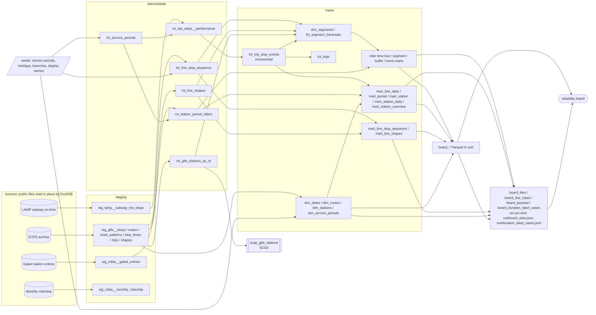

# Where the MBTA subway falls behind its schedule

A dbt project on public MBTA data. It compares every subway train's actual stop-to-stop run
times and gaps between trains against the published schedule, and weights the results by
fare-gate entries to show where it affects the most riders.

Public MBTA data. Live positions from the MBTA V3 API. Not affiliated with the MBTA.

Stack: dbt Core 1.12 + dbt-duckdb, with DuckDB as the warehouse. The whole pipeline is dbt:
DuckDB reads the MBTA files in place over HTTP (httpfs), dbt builds and tests the models,
writes the Parquet exports and, in an on-run-end hook, `out/board_data.json`. There are no
scripts outside dbt. Everything is open source; no accounts, keys or paid services are needed.

## The question

Which lines, stations and times of day run furthest behind schedule or leave the longest gaps
between trains, and how many riders does that touch? And is the data current?

Measures (all from `fct_trips` and `fct_trip_stop_events`; lines and the whole system use the
same grain):

- **Excess per trip**: for one train run, the sum of (actual minus scheduled) arrival-to-arrival
  time over its compared stop-to-stop segments. Averages are per train run, not per stop.
- **Late trip**: a train run whose excess per trip is more than 5 minutes. The same rule on every
  line, so long lines are more exposed to it.
- **Excess vs schedule**: total excess divided by total scheduled run time. Use this to compare
  lines of different length.
- **Long gap**: a train leaves a station more than 1.5x the scheduled gap after the previous train
  on the same line. Under 0.5x is **bunched**. Counted per departure.
- **Entries during long gaps**: for each station, line and service period, average weekday
  fare-gate entries times the long-gap share for that cell, summed. MBTA's gated-entry data
  splits each entry at transfer stations across lines (fractional counts), so nothing is counted
  twice. It is an estimate of entries, not a count of people who waited.
- **Freshness**: latest service date loaded vs. today.

The late-trip, excess and long-gap headline numbers are over **all days** (weekdays, Saturdays,
Sundays and holidays). Each of those tiles also carries the weekday-only value as a separate
field (`value_weekday`) for the board's day toggle. The entries-during-long-gaps number is
weekdays only. Day types come from `dim_dates`; holidays are a seed and are listed in
`board_data.json` under `meta.holidays`.

Thresholds are dbt vars (`late_trip_seconds`, `long_gap_ratio`, `bunched_ratio`).

## Decision metrics

These say where riders lose the most time, whether it is the schedule or the service, and what
is getting worse. All are dbt models with contracts and tests; the headline is in
`board_data.json` (`tiles[0]` and the `decision` block) and the detail is in Parquet.

- **Rider time lost** (main measure, `mart_station_rider_time_lost`, then
  `mart_rider_time_lost_daily` and `mart_rider_time_lost_weekly`). Per station, line, service
  date and service period:
  - *excess wait* = expected wait with the actual gaps between trains minus expected wait with
    the scheduled gaps. For someone arriving at a random time the expected wait is
    sum(h²) / (2 · sum(h)) over the gaps h, so one long gap costs more than two short ones.
    Both directions are pooled. Gaps over 1 hour (`wait_max_headway_seconds`) are a suspension
    or missing data, not a wait, and are left out of both sums (1,419 of 3.1 million gaps).
  - *excess ride* = average excess run time on the segments that start at the station, i.e. the
    first segment after boarding. Riders usually go further, so this part is a lower bound;
    there is no origin-destination data to do better.
  - weighted by average daily gated entries for the station, line, day type and period. The
    result is in exact rider-seconds and is an **estimate** (entries, not people).
  - Not clamped at 0: where trains ran closer together or faster than scheduled, that offsets
    places where they ran worse, so the total is net time lost.
  - The system total per date is the sum of the cells; the headline is the average weekday,
    with the all-days average next to it. Ungated stations (most Green Line surface stops and
    Mattapan) have no weight and add nothing. Labor Day has no weight either, because the rider
    basis window (July and August) has no holiday, so it is left out of the averages.
- **Segments** (`dim_segments`, `fct_segment_traversals`, `mart_segment_daily`,
  `mart_segment_reliability`). A segment is two consecutive stations on a line's canonical
  pattern in one direction; branches that share track share segments (254 segments). Each train
  run between them is a traversal with actual and scheduled run time. Geometry is the GTFS track
  shape between the points nearest the two stations (a straight line is the fallback; all 254
  have a shape). Rider-weighted loss per segment = entries at the start station × the segment's
  share of departures from that station × its average excess, so segment losses add up to the
  in-vehicle part of rider time lost. Segments are ranked by average weekday loss; the
  **top-10 share** is the top 10's loss over the sum of all positive segment losses.
- **Buffer time** (`mart_segment_reliability`, `mart_line_buffer`): p90 minus median actual run
  time, the extra time to plan to be on time 9 times out of 10. Buffer index = buffer / median.
  Line values are weighted by runs; they are per-segment averages, not trip totals, because
  segment p90s do not all happen on the same trip.
- **Getting worse** (`mart_segment_trend`, `mart_station_trend`): the last 14 service dates
  against the 28 before them. Reported: the change in average excess per run (segments) or
  per rider (stations: excess wait + excess ride pooled over each window), and the change in
  share of rider time lost. Flagged only with at least 300 runs or departures in the recent
  window and 600 in the prior one (about 21 a day; below that a few odd days move the average),
  and when excess rose by at least 5 s and by at least 5 s more than the typical (median)
  change. The whole system got slower in the recent window, so a flag means "worse than the
  rest", not just "worse".
- **Schedule or service** (`mart_segment_reliability.cause_class`): on each date with at least
  20 runs, the segment's average excess. Bias = median of those daily values, variability =
  their interquartile range. 'schedule' if |bias| ≥ 2 × IQR (consistently off: the scheduled
  time is wrong), 'service' if IQR ≥ 2 × |bias| (fine some days, bad others), otherwise 'mixed';
  fewer than 20 such dates is 'insufficient_data'.

All thresholds are dbt vars (`wait_max_headway_seconds`, `worse_*`, `cause_*`) and are listed in
`board_data.json` under `meta.thresholds`.

### Durations

Times are stored in exact seconds. Every exported time measure has `<metric>_seconds` and
`<metric>_label`; labels come from the `format_duration` macro:

- two largest units: `55 s`, `1 min 29 s`, `1 h 3 min`, `2 days 4 h`, `3 months 10 days`,
  `1 year 2 months`; 1 month = 30 days, 1 year = 365 days; day, month and year are singular
  for 1; a zero second unit is dropped (`1 h`, `2 days`).
- rounding: only what is cut below the second unit is rounded, to the nearest second unit,
  halves up, and a full unit carries upward. 119 s stays `1 min 59 s` and 3599 s stays
  `59 min 59 s` (nothing is cut), 3655 s is `1 h 1 min`, 3750 s (1 h 2 min 30 s) is `1 h 3 min`,
  86380 s (23 h 59 min 40 s) is `1 day`, 1 day 0 h 30 min is `1 day 1 h`. Fractions of a second
  count as the cut part (59.5 s is `1 min`). At the year level 12 months carry into a year.
- `out/duration_label_cases.json` is an array of `{seconds, label}` from the macro: every unit
  boundary and rounding step (seed `duration_label_boundaries`) plus a few large real values
  from the marts. The board's own formatter is tested against it. dbt unit tests check the
  macro on the same cases, and a post-build test checks the file matches the model.

## Lineage



The full graph, with column docs, is in the dbt docs site (`docs/dbt/index.html`).

## Layers

| Layer | Models | Materialization |
|---|---|---|
| Staging | 9 models, one per source table: rename, cast, dedupe, parse dates. They read the remote files directly (see Loading) | LAMP: incremental; GTFS and Open Data: tables kept between builds (see Loading) |
| Intermediate | `int_trip_stops__performance` (run times, headways, flags per arrival), `int_service_periods` (minute of day to MBTA service period), `int_line_stop_sequence`, `int_line_shapes`, `int_station_period_riders`, `int_gtfs_stations_as_of` | view, access protected |
| Marts | `dim_dates`, `dim_routes`, `dim_stations`, `dim_service_periods`, `dim_segments`, `fct_trip_stop_events`, `fct_trips`, `fct_segment_traversals`, `mart_line_daily_reliability`, `mart_period_reliability`, `mart_station_reliability`, `mart_station_daily_reliability`, `mart_station_overview`, `mart_line_stop_sequence`, `mart_line_shapes`, `mart_data_coverage`, `mart_station_rider_time_lost`, `mart_rider_time_lost_daily`, `mart_rider_time_lost_weekly`, `mart_segment_daily`, `mart_segment_reliability`, `mart_line_buffer`, `mart_segment_trend`, `mart_station_trend` | table (fact incremental), access public, contracts enforced |
| Exports | 15 `board_*` models written to `out/*.parquet` (zstd) for the board; `board_tiles`, `board_line_totals`, `board_payload` and `board_duration_label_cases` hold the JSON for `out/board_data.json` and `out/duration_label_cases.json` | external (Parquet); the four JSON models are tables |

Star schema: `fct_trip_stop_events` (one row per service date, trip, route, vehicle and stop) and
`fct_trips` (one row per train run) join to `dim_dates`, `dim_routes`, `dim_stations` and
`dim_service_periods`. Every model description starts with its grain. Surrogate keys come from
`dbt_utils.generate_surrogate_key`.

Service periods follow the MBTA Service Delivery Policy (Sunrise, Early AM, AM Peak, Midday Base,
Midday School, PM Peak, Evening, Late Evening, Night), stored as a seed.

Conventions are in [CONVENTIONS.md](CONVENTIONS.md).

## Loading

There is no separate load step. Each source in `models/staging/_sources.yml` has an
`external_location`, so `{{ source() }}` renders to a DuckDB read of the public file
(`read_parquet` / `read_csv` over HTTPS, via the httpfs extension set in `profiles.yml`).

- **LAMP** (`stg_lamp__subway_trip_stops`, incremental on `service_date`): the macro
  `lamp_files_to_load()` (`macros/lamp_files.sql`) queries the LAMP `index.csv` with
  `run_query` and builds the list of Parquet URLs to read. On an incremental run that is every
  date from the latest loaded date minus `incremental_lookback_days` (3, so 4 dates are re-read,
  because LAMP republishes recent files) up to yesterday in Boston. On a first build or
  `--full-refresh` it is `lamp_start_date` to `lamp_end_date` if set, otherwise the last
  `lamp_window_days` (90) complete service dates.
- **GTFS archive** (one Parquet file per year and GTFS file) and the **Open Data** CSVs
  (gated entries, monthly ridership) are too large to download on every build (about 80 MB for
  `stop_times` alone). Their staging models are tables that keep their rows between builds: the
  remote file is read on the first build, on `--full-refresh`, or with
  `--vars '{refresh_reference: true}'` (the daily workflow sets it once a day). Otherwise the
  model inserts nothing and the existing rows stay. GTFS years come from `gtfs_years`
  (default `[2026]`); `assert_gtfs_covers_lamp_window` fails if the LAMP window needs a year that
  is not listed.
- **Sample**: `--vars '{use_sample: true}'` points every source at the small copies committed in
  `data/sample/` (two real LAMP service dates, 2026-08-27 and 2026-08-28, with a matching
  `index.csv`, subway-only GTFS subsets and gzipped Open Data CSVs). CI uses it.
- Any location can be overridden with a var (`lamp_index_url`, `gtfs_archive_url`,
  `gated_entries_url`, `monthly_ridership_url`), for example to build from a local mirror.

## Tests and contracts

404 data tests and 3 unit tests on the full build: 395 data tests pass, 9 warn, 0 fail (plus 3
incremental checks and 2 post-build checks that run only when their var is set, see below).

- Generic: `unique`, `not_null`, `relationships`, `accepted_values`,
  `dbt_utils.unique_combination_of_columns`, `dbt_utils.accepted_range`.
- Custom generic (`macros/generic_tests/`): `is_share` (0 to 1), `has_prefix` (station ids
  start with `place-`), `contiguous_sequence` (stop order 1..n with no gaps).
- Singular (`tests/`): line-daily totals reconcile to the fact table, no missing service dates,
  every observed station is on the network, adjacent stops are under 6 km apart, service periods
  cover all 1,440 minutes exactly once, every map station has coordinates, board route ids match
  the MBTA V3 API, and more.
- Board numbers (`tests/kpi/`): each headline tile, its weekday value, and each line's late
  share and excess per trip are recomputed from `fct_trips` / `fct_trip_stop_events` (not from
  the marts) and compared to the export models, failing beyond rounding (1e-4 for shares,
  0.06 s for seconds, 1 entry or 0.1% for the rider tile). Also: coverage counts match the fact,
  ungated stations have no rider rows, every map branch has its stops in order and a track shape
  inside Greater Boston, and every Parquet file listed in `board_data.json` has its model's row
  count.
- Decision metrics (`tests/kpi/`): the rider-time-lost tile is recomputed from the facts and
  the rider weights; daily, weekly, station and segment totals add up; the cause class, rank,
  top-10 flag and getting-worse flags follow their rules; the `decision` block matches the
  marts; every segment geometry starts and ends within 500 m of its stations.
- Unit tests (`models/exports/_exports.yml`): `format_duration` on the unit boundaries (59, 60,
  3599, 3600, 86399, 86400 s, 30 days, 365 days), on the rounding rule, and on real values.
- Build result: the on-run-end hook stores every node's result in `audit.build_results`, and
  writes `out/board_data.json` only if no model or test errored or failed (otherwise the previous
  file stays). `tests/assert_build_has_no_failures.sql` reads that table; a test cannot see the
  invocation it runs in, so it runs right after the build, together with
  `tests/assert_duration_cases_file_matches.sql`:
  `dbt test --select tag:post_build --vars '{check_build: true}'`. The exit code of
  `dbt build` is the other half of that check.
- All 24 public marts have enforced contracts (column names and data types checked at build time).

### Data quality findings (severity warn)

These come from the source data. They are kept as warnings so they show up in every run.

| Test | Rows | What it means |
|---|---|---|
| `accepted_range` on scheduled trunk headway (staging and fact) | 81,276 | LAMP gives a scheduled headway of 0 seconds; these arrivals are left out of gap ratios |
| `accepted_range` on scheduled run seconds (fact) | 4,616 | Segments whose scheduled run time is zero or negative; left out of excess-time comparisons |
| `assert_scheduled_run_not_negative` | 3,733 | Scheduled run time between consecutive stops is negative in LAMP |
| `assert_trip_ids_not_reused_across_routes` | 3,539 | The same trip id appears at the same stop on more than one route on a date (1,316 also on two vehicles, 837 involve added trips). Route and vehicle are part of the fact grain, so the rows are kept |
| `assert_travel_outliers` | 3,266 | Stop-to-stop excess over 30 minutes (disruptions, shuttles, data gaps); kept in counts, flagged in the fact |
| `assert_gtfs_validity_ranges` | 174 | GTFS archive records whose end date is before their start date |
| `assert_gated_entries_no_missing_dates` | 46 | Station and line combinations with missing days in gated entries |
| `not_null` on gated entries `station_id` | 12 | Longwood rows with no stop id; excluded from rider weights |

## Incremental model and freshness

`fct_trip_stop_events` is incremental (`delete+insert` on `trip_stop_event_key`). Each run
reprocesses every service date within `incremental_lookback_days` (3) of the latest date already
in the table, because LAMP republishes recent days, and adds any newer dates.

The LAMP staging table is incremental the same way (`delete+insert` on `service_date`), so a
daily build downloads only the lookback dates and the new date.

To check it, save the per-date state, build a newer date, and run the three tests in
`tests/incremental/` (a newer date was added, dates older than the lookback kept the same row
counts and `loaded_at`, and fact rows per date equal staging):

```bash
dbt build --profiles-dir . --full-refresh --vars '{lamp_end_date: 2026-10-05}'
dbt run-operation save_incremental_state --profiles-dir .      # writes audit.incremental_state
dbt build --profiles-dir . --vars '{lamp_end_date: 2026-10-06, check_incremental: true}'
```

CI runs the same sequence on every push with the two sample dates.

Run on the full window (2026-07-09 to 10-05 with a full refresh, then 2026-10-06 built
incrementally): 89 dates / 3,591,892 rows before, 90 dates / 3,641,449 rows after, 5 LAMP files
read by the incremental run (2026-10-02 to 10-05 reprocessed, plus 10-06), the other 85 dates
untouched (same row counts and load times). The outputs were identical to a full build of the
90 dates.

Source freshness on LAMP: warn after 2 days, error after 4 days, on the service date.
`dbt source freshness --profiles-dir .`

## Snapshot

`snap_gtfs_stations` is a type 2 slowly changing dimension of station attributes (name,
coordinates, municipality, wheelchair boarding), built from the GTFS archive version active on
each date. A normal `dbt build` adds the version active on the latest loaded date. To replay
history, so it starts at the first 2026 GTFS version (2026-01-01) instead of the day the project
was first run, rebuild `int_gtfs_stations_as_of` for each as-of date in order and snapshot it.
`station_snapshot_replay_dates` prints the dates (first loaded date, each date a station's
attributes changed, last loaded date); with `reset: true` it drops the snapshot first:

```bash
for d in $(dbt --quiet run-operation station_snapshot_replay_dates --args '{reset: true}' --profiles-dir .); do
  dbt build --profiles-dir . -s int_gtfs_stations_as_of snap_gtfs_stations --vars "{gtfs_as_of: '$d'}"
done
dbt run --profiles-dir . -s int_gtfs_stations_as_of      # back to the latest as-of date
```

For the current window the dates are 20260709, 20260731, 20260917 and 20261006. The daily
workflow runs this when it starts from an empty warehouse.

Real changes it picked up in 2026, all on the Green Line C branch:

- Englewood Avenue and Tappan Street: `wheelchair_boarding` changed from 2 (not accessible) to
  1 (accessible) on 2026-07-31. Englewood Avenue's coordinates also moved.
- Dean Road: coordinates moved on 2026-09-17.

128 snapshot rows for 125 stations.

## Semantic layer

`models/marts/_semantic.yml` defines two semantic models (`trip_stop_events`, `trips`) and 12
metrics, including `late_trip_share`, `long_gap_share`, `headway_adherence` and
`excess_travel_minutes`, with `dim_dates` as the time spine. It passes `dbt parse`. MetricFlow itself
(`dbt-metricflow`) is not installed, so the metrics have not been queried on DuckDB. The same
numbers are computed in the marts and checked by the tests in `tests/kpi/`.

## Exposure and board files

The board is declared as a dbt exposure (`reliability_board`, type application) that depends on
the fifteen Parquet export models, `board_duration_label_cases` and `board_payload`. Exports are Parquet files in `out/` that the board queries in
the browser with DuckDB-WASM:

| File | Grain | Size |
|---|---|---|
| `line_daily.parquet` | route x service date (with `day_type`) | 39 KB |
| `line_periods.parquet` | route x day type x service period | 14 KB |
| `station_periods.parquet` | station x line x day type x service period | 83 KB |
| `station_daily.parquet` | station x line x service date x service period (additive counts, with `day_type`) | 544 KB |
| `map_stations.parquet` | station, with coordinates and map values | 10 KB |
| `line_stops.parquet` | branch x direction x stop order | 9 KB |
| `line_shapes.parquet` | branch x direction x track point | 40 KB |
| `routes.parquet` | route | 1 KB |
| `service_periods.parquet` | service period | 1 KB |
| `segments.parquet` | track segment, with geometry, buffer, rider-weighted loss, rank, cause class and trend | 83 KB |
| `rider_time_lost_daily.parquet` | service date | 8 KB |
| `rider_time_lost_weekly.parquet` | week (Monday start) | 4 KB |
| `station_time_lost.parquet` | station x line x day type x service period | 211 KB |
| `station_trend.parquet` | station x line | 17 KB |
| `line_buffer.parquet` | line | 3 KB |

The six decision files store exact seconds with a label next to each time measure. The first
nine files keep their rounded columns as they were, so they have no `_label` columns.

`out/board_data.json` is built in dbt too. `board_tiles` (one row per headline tile),
`board_line_totals` (one row per route) and `board_payload` (one row, one JSON column per block:
meta, tiles, lines, worst stations, worst periods, map with stations, ordered stop lists, track
shapes and period values, files, data coverage, decision, glossary) are DuckDB tables built with
`json_object` and lists. Glossary and source text are seeds (`board_glossary`, `board_sources`).
The on-run-end hook (`macros/write_build_outputs.sql`) adds the `build` block, put together in
Jinja from the run's `results` (totals by status and by resource type, test counts, warned
tests) and the project `graph` (models by layer, contracted, incremental and external models,
lineage edges), and COPYs the row to `out/board_data.json`. It also writes
`out/build_results.json` (unique_id, resource_type, name, status, execution_time, failures,
message for every node) and `out/duration_label_cases.json`. They are written only when `board_payload` was built in that
invocation and nothing errored or failed, so a partial run such as `dbt build -s board_payload`
gives a build block that covers only that run.

## CI and daily refresh

- `.github/workflows/dbt_ci.yml` (push, pull request): installs the pinned requirements (dbt
  and sqlfluff), runs `sqlfluff lint`, builds the committed sample with `--full-refresh` for the
  first date, saves the incremental state, builds the second date incrementally with the
  incremental tests on, runs the post-build check, and generates docs. No calls to MBTA and no
  secrets.
- `.github/workflows/daily_refresh.yml` (daily at 11:30 UTC): restores the DuckDB file from
  `actions/cache`, runs source freshness and `dbt build --vars '{refresh_reference: true}'`
  (only new LAMP dates on a cache hit, the default 90-day window on a miss, when it also replays
  the station snapshot), runs the post-build check, saves the DuckDB file back to the cache,
  generates docs into `docs/dbt/`, and publishes `docs/` (site root) plus `out/` with
  `actions/upload-pages-artifact` and `actions/deploy-pages`. It never commits to the repository.

## How to run

Install dbt: `python3 -m venv .venv && . .venv/bin/activate && pip install -r requirements.txt`

```bash
dbt deps --profiles-dir .

# full data: last 90 complete service dates, read straight from MBTA (about 300 MB)
dbt build --profiles-dir .

# or a fixed window
dbt build --profiles-dir . --full-refresh --vars '{lamp_start_date: 2026-07-09, lamp_end_date: 2026-10-06}'

# or offline, from the committed sample
dbt build --profiles-dir . --full-refresh --vars '{use_sample: true}'

# daily update: new LAMP dates only; re-read GTFS and Open Data
dbt build --profiles-dir . --vars '{refresh_reference: true}'

# check the last build had no failures
dbt test --profiles-dir . --select tag:post_build --vars '{check_build: true}'

# docs (single static file, opens from disk)
dbt docs generate --profiles-dir . --static --target-path target_docs
mkdir -p docs/dbt && cp target_docs/static_index.html docs/dbt/index.html

# lint
sqlfluff lint models tests
```

Every build writes `out/*.parquet`, `out/board_data.json` and `out/build_results.json`.
Paths can be changed with `MBTA_DUCKDB_PATH` (warehouse file) and `MBTA_OUT_DIR` (export folder).

## Findings

Window: 90 service dates, 2026-07-09 to 2026-10-06. 3,641,449 train-at-stop records,
352,266 train runs observed, 222,811 of them with at least one segment comparable to schedule.
The tests in `tests/kpi/` recompute each number below from the fact tables on every build.

| Figure | All days | Weekdays | Definition |
|---|---|---|---|
| Late trips | **11.0%** | 11.9% | Share of compared train runs (222,811 on all days) more than 5 minutes over scheduled time |
| Excess per trip | **+35.2 s** | +46.4 s | Average per train run; on all days 1.9% of an average 31-minute scheduled run (weekdays 2.4%) |
| Long gaps | **17.3%** | 17.9% | Share of departures (3,131,460 on all days) more than 1.5x the scheduled gap after the previous train |

Weekdays exclude holidays (Labor Day, 2026-09-07, is the one holiday in the window).

| Figure | Value | Definition |
|---|---|---|
| Weekday entries during long gaps | **about 50,300** | Of 302,700 average weekday gate entries at 68 gated stations (16.6%). Average over all days, weekends included: about 39,600 |
| Red Line excess per trip | **+145.5 s** | Same per-trip grain as the system figure |

Line figures below are over all days; time-of-day and station figures say weekday where they are.

- **Red Line is most often late: 20.9% of its trips are 5+ minutes over,** and it averages
  145.5 s over per trip. Part of that is length: a Red Line trip is scheduled for 38 minutes on
  average against 31 systemwide. Relative to scheduled time Red runs 6.3% over.
- **Blue Line runs furthest over its schedule relative to trip length: 8.5%** (94 s on an
  18-minute trip), but only 9.5% of its trips cross the fixed 5-minute line.
- Others, late share / excess vs schedule: Green D 15.3% / 1.0%, Green E 13.4% / -0.2%,
  Green B 9.8% / -0.3%, Green C 8.7% / -0.1%, Orange 5.6% / 1.6%, Mattapan 1.5% / -15.1%.
  Green branches average close to schedule but have a wide spread, so many trips still end up
  late.
- **The Green Line has the most uneven gaps.** Long-gap share: Green D 25.9%, Green E 23.2%,
  Green B 21.3%, Green C 20.4%, against 9.7% on Orange and 7.0% on Mattapan. Green branches also
  bunch most (13 to 16% of departures under half the scheduled gap).
- **Worst time of day: weekday Red Line PM Peak (4:00 to 6:29 PM), 33.6% of trips 5+ minutes
  late,** then Red Line Midday Base (29.1%) and Midday School (26.0%). Across all lines, weekday
  PM Peak (15.0%) and Midday Base (14.7%) are the worst periods; AM Peak is 10.3%.
- **Stations, average weekday entries during long gaps:** Park Street about 2,900 of 11,300,
  North Station 2,700 of 15,200, Government Center 2,300 of 6,400 (its departures are long gaps
  36.5% of the time, rider-weighted), South Station 2,000 of 10,800, Downtown Crossing 1,900 of
  12,600.
- **Freshness:** data runs through 2026-10-06, one day behind, which is LAMP's normal lag.

Decision metrics (estimates; exact seconds in the files, labels as on the board):

- **Rider time lost: about 15.07 million rider-seconds on an average weekday (5 months 24 days),
  53 s per gate entry.** 12.46 million of it is waiting (4 months 24 days) and 2.61 million is
  riding (1 month). Over all days the average is 13.35 million (5 months 5 days). Weekly, the
  average weekday ranged from 3 months 26 days (week of Sep 7) to 7 months 22 days (week of
  Aug 17).
- **The top 10 segments carry 41.5% of the in-vehicle loss across segments.** All are on the
  Red, Blue and Orange lines (the Green Line surface has no gate data to weight it): Ashmont to
  Shawmut 11.3%, Davis to Alewife 4.9%, South Station to Broadway 4.5%, North Quincy to
  JFK/UMass 3.6%, Airport to Maverick 3.5%, then Maverick to Airport, North Station to
  Haymarket, Central to Kendall/MIT, Broadway to South Station and Orient Heights to Wood
  Island.
- **Schedule or service:** of 254 segments, 107 are 'schedule' (consistently over or under
  the scheduled time), 46 'service' (varies day to day), 96 'mixed', 5 with too little data.
  Seven of the top 10 are 'schedule'.
- **Buffer index by line:** Green 0.40, Red 0.32, Blue 0.26, Mattapan 0.18, Orange 0.18.
- **Getting worse (Sep 23 to Oct 6 against Aug 26 to Sep 22):** the system got slower overall
  (42 to 57 s lost per entry), so the flag picks out what got worse than the rest: 42 segments
  and 48 station-lines. Largest: Longwood Medical Area to Brigham Circle (+63 s per run),
  Ashmont to Shawmut (+25 s), Lechmere to Union Square (+23 s); North Station on the Green Line
  (+151 s per rider, +5.7 points of the loss share), Cleveland Circle and Union Square.

## Limits

Data coverage (`mart_data_coverage`, also in `out/board_data.json` under `coverage`):

| Route | Trip-stop events | No scheduled travel time | No scheduled headway | Neither | Events at ungated stations |
|---|---|---|---|---|---|
| Red | 612,030 | 47,900 (7.8%) | 7,775 (1.3%) | 6,636 (1.1%) | 0% |
| Mattapan | 168,949 | 23,529 (13.9%) | 1,305 (0.8%) | 185 (0.1%) | 74.7% |
| Orange | 659,500 | 39,356 (6.0%) | 1,851 (0.3%) | 112 (0.0%) | 0% |
| Green B | 438,946 | 45,626 (10.4%) | 21,911 (5.0%) | 3,762 (0.9%) | 73.1% |
| Green C | 373,473 | 43,201 (11.6%) | 21,765 (5.8%) | 3,985 (1.1%) | 65.7% |
| Green D | 523,493 | 107,840 (20.6%) | 72,589 (13.9%) | 47,731 (9.1%) | 52.2% |
| Green E | 483,579 | 58,138 (12.0%) | 22,883 (4.7%) | 2,209 (0.5%) | 33.5% |
| Blue | 381,479 | 36,348 (9.5%) | 1,936 (0.5%) | 566 (0.1%) | 0% |
| All | 3,641,449 | 401,938 (11.0%) | 152,015 (4.2%) | 65,186 (1.8%) | 31.0% |

"No scheduled travel time" means LAMP has no scheduled run time from the previous stop, or it is
zero or less; it includes the first stop of every trip and added trips. Those events are left out
of excess-time figures, and events with no scheduled headway are left out of gap figures. Green D
has the most unmatched events, mostly added trips.

57 of 125 stations have no gated-entry data and so no rider weight: 51 Green Line stations and 6
Mattapan trolley stops. Ids:
Green: place-alsgr, place-amory, place-babck, place-bckhl, place-bcnfd, place-bcnwa, place-bland,
place-bndhl, place-brico, place-brkhl, place-brmnl, place-bucen, place-buest, place-bvmnl,
place-chhil, place-chill, place-chswk, place-clmnl, place-cool, place-denrd, place-eliot,
place-engav, place-fbkst, place-fenwd, place-fenwy, place-grigg, place-harvd, place-hsmnl,
place-hwsst, place-kntst, place-lake, place-lngmd, place-longw, place-mfa, place-mispk,
place-newtn, place-newto, place-nuniv, place-rsmnl, place-rvrwy, place-smary, place-sougr,
place-sthld, place-stpul, place-sumav, place-symcl, place-tapst, place-waban, place-wascm,
place-woodl, place-wrnst.
Mattapan: place-butlr, place-capst, place-cedgr, place-cenav, place-miltt, place-valrd.

Green Line surface share: 51 of 70 Green Line stations (72.9%) and 55.1% of Green Line trip-stop
events are at stations without gated data. This counts ungated stations as surface; the two
exceptions are Symphony (underground, no gate data) and Longwood (its gated rows have no stop id).

Other limits:

- Schedule comparison is only as good as the scheduled values in LAMP. Added trips and the first
  stop of each trip have no scheduled run time or headway and are left out of the ratios (see the
  warn tests above).
- The first segment of a trip uses departure-to-arrival time, because the time a train sits at
  its origin terminal is layover, not delay.
- Rider weights use gated entries only (2026-07-07 to 2026-08-31, the latest published). 68 of 125
  stations have gated data; surface Green Line stops and Mattapan have no fare gates, so their map
  values fall back to arrival-weighted averages (`has_rider_data = false`).
- Entries during long gaps assumes entries are spread evenly across long and normal gaps within
  a station, line and service period, and credits each entry to the line MBTA assigns it to
  (a transfer from another line inside the station is not counted). Rider weights come from
  July and August; September ridership is likely higher, so it is probably an undercount.
- `trips` counts every observed train run, including about 115,000 records for added Green Line
  trips (most cover a single stop) that have no schedule to compare against. Use
  `trips_compared` as the denominator for trip shares, as the tiles do.
- Station snapshot history starts with the first 2026 GTFS archive version (2026-01-01).
- Metrics are defined and parsed but not queried with MetricFlow (see Semantic layer).
- Service alerts are not joined, so the project shows where and when, not why.
- Rider time lost is an estimate: entries, not people; the ride part counts only the first
  segment after boarding; ungated stations, transfers inside a station and the Labor Day
  holiday have no weight; gaps over 1 hour are left out. Rider weights are from July and August.
- A few trips repeat a `stop_sequence` (Mattapan and Union Square trips); traversals order
  stops by sequence, then event time. About 1.4% of compared arrivals follow a skipped or missing
  stop and are not a segment traversal.
- Segments next to a terminal can carry terminal effects. Ashmont to Shawmut (Red, northbound)
  ranks first: its median run is 55 s against 60 s scheduled, but about one run in ten takes
  over 6 minutes, which looks like trains held at or just after Ashmont rather than slow running.

## License

Code: MIT, see [LICENSE](LICENSE). Data: MBTA/MassDOT public data under the MBTA's own terms,
not the MIT license. Sources and terms are listed in [data/README.md](data/README.md).
