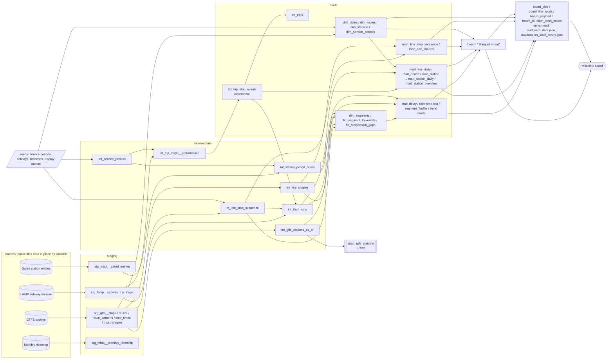

# Lantern

Where the T runs late, from recorded train runs.

Lantern is a dbt project on public MBTA data. The board is published at
https://neelvadlamudi.github.io/lantern/ (dbt docs at https://neelvadlamudi.github.io/lantern/dbt/);
the source is https://github.com/NeelVadlamudi/lantern. It compares every subway train's
recorded stop-to-stop run times and gaps between trains against the published schedule. The headline is measured train
time over schedule; an estimate of rider time lost, weighted by fare-gate entries, sits next to
it.

Public MBTA data. Live positions from the MBTA V3 API. Not affiliated with the MBTA.

Stack: dbt Core 1.12 + dbt-duckdb, with DuckDB as the warehouse. The whole pipeline is dbt:
DuckDB reads the MBTA files in place over HTTP (httpfs), dbt builds and tests the models,
writes the Parquet exports and, in an on-run-end hook, `out/board_data.json`. There are no
scripts outside dbt. Everything is open source; no accounts, keys or paid services are needed.

## The question

Which lines, stations and times of day run furthest behind schedule or leave the longest gaps
between trains, and how many riders does that touch? And is the data current?

Measures (all from `fct_trips` and `fct_trip_stop_events`; lines and the whole system use the
same grain):

- **Excess per trip**: for one train run, the sum of (actual minus scheduled) arrival-to-arrival
  time over its compared stop-to-stop segments. Averages are per train run, not per stop.
- **Late trip**: a train run whose excess per trip is more than 5 minutes. The same rule on every
  line, so long lines are more exposed to it.
- **Excess vs schedule**: total excess divided by total scheduled run time. Use this to compare
  lines of different length.
- **Long gap**: a train leaves a station more than 1.5x the scheduled gap after the previous train
  on the same line. Under 0.5x is **bunched**. Counted per departure.
- **Entries during long gaps**: for each station, line and service period, average weekday
  fare-gate entries times the long-gap share for that cell, summed. MBTA's gated-entry data
  splits each entry at transfer stations across lines (fractional counts), so nothing is counted
  twice. It is an estimate of entries, not a count of people who waited.
- **Freshness**: latest service date loaded vs. today.

The late-trip, excess and long-gap headline numbers are over **all days** (weekdays, Saturdays,
Sundays and holidays). Each of those tiles also carries the weekday-only value as a separate
field (`value_weekday`) for the board's day toggle. The entries-during-long-gaps number is
weekdays only. Day types come from `dim_dates`; holidays are a seed and are listed in
`board_data.json` under `meta.holidays`.

Thresholds are dbt vars (`late_trip_seconds`, `long_gap_ratio`, `bunched_ratio`).

## Decision metrics

These say where trains lose the most time against the schedule, how much of that reaches
riders, whether it is the schedule or the service, and what is getting worse. All are dbt
models with contracts and tests; the headline is in `board_data.json` (`tiles[0]` and the
`decision` block) and the detail is in Parquet. Measured values are not clamped, capped or
dropped: where something has to be told apart (late vs early, runs over 30 minutes, terminal
holds, gaps over 1 hour), it gets its own exact column and the totals still add up to what was
recorded.

- **Train time over schedule** (headline, measured; `int_train_runs`, `mart_train_delay_daily`,
  `mart_train_delay_summary`, tile `train_delay_weekday`). Every train run between two
  observed stops (3,289,183 in the window) is compared with its scheduled run time:
  - *positive excess* = max(run - scheduled, 0) per run, late time only;
  - *net excess* = run - scheduled, so early runs offset late ones.
  Both are summed over the runs of each service date. The headline is the average weekday,
  with the run count and the per-run average; the all-days figures are next to it. Runs over
  30 minutes (`travel_outlier_seconds`) are included and also given on their own. Runs that
  cannot be compared are counted by reason and not summed: no actual time, no scheduled time,
  actual time zero or negative (a LAMP timestamp problem), scheduled time zero or negative.
- **Run time and terminal holds** (`int_train_runs`). LAMP gives each stop an arrival time and,
  through the next stop's record, a departure time. The run time is arrival to arrival, except
  on a trip's first observed stop (departure to arrival) and on runs that leave a line or
  branch terminal (`is_terminal_departure`): there the recorded dwell at the terminal,
  departure minus arrival, is split into `terminal_hold_seconds` and the run time is departure
  to arrival. `actual_run_seconds` keeps the recorded arrival-to-arrival time, so
  `actual_run_seconds = run_seconds + terminal_hold_in_actual_seconds` on every row. On runs
  that end at a terminal (`is_terminal_arrival`) LAMP has only the arrival time, so time spent
  holding outside the terminal cannot be split; the full time stays in the run and the segment
  is marked `terminal_time_split = 'arrival_not_split'`. 32 of 254 segments touch a terminal
  (16 leave one, 16 end at one).
- **Segments** (`dim_segments`, `fct_segment_traversals`, `mart_segment_daily`,
  `mart_segment_reliability`). A segment is two consecutive stations on a line's canonical
  pattern in one direction; branches that share track share segments (254 segments). Each run
  over it is a traversal from `int_train_runs`, compared or not. Geometry is the GTFS track
  shape between the points nearest the two stations (a straight line is the fallback; all 254
  have a shape). Segments are ranked by measured train delay: positive excess summed over
  weekday runs, per average weekday (`avg_weekday_positive_excess_seconds`). Net excess, runs
  over 30 minutes and terminal holds are in their own columns. The **top-10 share** is the top
  10's weekday train delay over the sum across all segments. Per segment,
  `mart_segment_concentration` adds the distribution of terminal holds (median, p90 and mean
  per run, as recorded) and the **worst 14-day window** (`worst_window_days`): of every run of
  14 consecutive calendar days inside the loaded dates, the one holding the largest share of the
  segment's train delay, with that share and the window's share of the segment's compared runs.
  Riders are not used in the rank;
  the only rider number on a segment is the people entering its start station
  (`start_station_avg_weekday_entries`, where that station has gate data).
- **Rider time lost** (secondary, an **estimate**; `mart_station_rider_time_lost`, then
  `mart_rider_time_lost_daily` and `mart_rider_time_lost_weekly`). It is based on people
  entering stations and assumes riders arrive at random times. Per station, line, service date
  and service period:
  - *excess wait* = expected wait with the actual gaps between trains minus expected wait with
    the scheduled gaps. For someone arriving at a random time the expected wait is
    sum(h²) / (2 · sum(h)) over the gaps h (the standard headway-based formula), so one long gap
    costs more than two short ones. Both directions are pooled.
  - *excess ride* = average net excess run time on the segments that start at the station, i.e.
    the first segment after boarding. Riders usually go further, so this part is a lower bound;
    there is no origin-destination data to do better.
  - weighted by average daily gated entries for the station, line, day type and period. The
    result is in exact rider-seconds (entries, not people).
  - Not clamped at 0: where trains ran closer together or faster than scheduled, that offsets
    places where they ran worse, so the total is net time lost.
  - `share_of_total_rider_time_lost` = a cell's wait + ride over the total of all cells.
  - The system total per date is the sum of the cells; the headline is the average weekday,
    with the all-days average next to it. Ungated stations (most Green Line surface stops and
    Mattapan) have no weight and add nothing. Labor Day has no weight either, because the rider
    basis window (July and August) has no holiday, so it is left out of the averages.
- **Gaps over 1 hour** (`fct_suspension_gaps`). 1,419 of 3,131,460 gaps between trains are over
  `wait_max_headway_seconds` (1 hour), 10,932,746 s in all, mostly suspensions with shuttle
  buses. They are kept in their own columns (`suspension_gap_count`, `suspension_gap_seconds`)
  in the station, daily and weekly rider marts, `station_time_lost.parquet` and
  `board_data.json`, and the wait is given twice: without them, and with the ones that were
  passenger waits (`*_with_gaps`). Each gap is checked against the recorded departures at the
  same platform (`gap_kind`):
  - `spans_service_day_boundary`: the train that opened the gap ran on an earlier service
    date, so the gap runs through the overnight break and is not a wait
    (`is_passenger_wait = false`). **0 gaps**: LAMP's headways never cross a service date.
  - `departure_recorded_inside`: other trains were recorded leaving the platform inside the
    gap (80 gaps, 820,276 s, 569 departures). The gap is kept as a wait, split at those
    departures: its squared term is the sum of the squared pieces
    (`recorded_gap_squared_sum`).
  - `departure_not_recorded`: the departure that closes the gap has no timestamp (114 gaps,
    1,849,876 s), so it cannot be checked; kept as a wait.
  - `no_departure_recorded_inside`: nothing recorded inside (1,225 gaps, 8,262,594 s); a wait.
  179 gap starts do not match a departure in the files (114 of them the unrecorded kind); their
  service date is null and they stay waits.
- **Buffer time** (`mart_segment_reliability`, `mart_line_buffer`): p90 minus median run time,
  the extra time to plan to be on time 9 times out of 10. Buffer index = buffer / median. Line
  values are weighted by runs; they are per-segment averages, not trip totals, because segment
  p90s do not all happen on the same trip.
- **Getting worse** (`mart_segment_trend`, `mart_station_trend`): the last 14 service dates
  against the 28 before them. The flag uses the change in average net excess per run
  (segments) or per rider (stations: excess wait + excess ride pooled over each window). It is
  set only with at least 300 runs or departures in the recent window and 600 in the prior one
  (about 21 a day; below that a few odd days move the average), and when excess rose by at
  least 5 s and by at least 5 s more than the typical (median) change. The recent and prior
  values, the deltas and the volumes are in the files for every row, flagged or not, along
  with train delay per day and its share (segments) and the with-gaps values (stations).
- **Schedule or service** (`mart_segment_reliability.cause_class`): on each date with at least
  20 runs, the segment's average net excess. Bias = median of those daily values, variability =
  their interquartile range. 'schedule' if |bias| ≥ 2 × IQR (consistently off: the scheduled
  time is wrong), 'service' if IQR ≥ 2 × |bias| (fine some days, bad others), otherwise 'mixed';
  fewer than 20 such dates is 'insufficient_data'.

All thresholds are dbt vars (`travel_outlier_seconds`, `wait_max_headway_seconds`, `worse_*`,
`cause_*`) and are listed in `board_data.json` under `meta.thresholds`.

### Durations

Times are stored in exact seconds. Every exported time measure has `<metric>_seconds` and
`<metric>_label`; labels come from the `format_duration` macro:

- two largest units: `55 s`, `1 min 29 s`, `1 h 3 min`, `2 days 4 h`, `3 months 10 days`,
  `1 year 2 months`; 1 month = 30 days, 1 year = 365 days; day, month and year are singular
  for 1; a zero second unit is dropped (`1 h`, `2 days`).
- rounding: only what is cut below the second unit is rounded, to the nearest second unit,
  halves up, and a full unit carries upward. 119 s stays `1 min 59 s` and 3599 s stays
  `59 min 59 s` (nothing is cut), 3655 s is `1 h 1 min`, 3750 s (1 h 2 min 30 s) is `1 h 3 min`,
  86380 s (23 h 59 min 40 s) is `1 day`, 1 day 0 h 30 min is `1 day 1 h`. Fractions of a second
  count as the cut part (59.5 s is `1 min`). At the year level 12 months carry into a year.
- `out/duration_label_cases.json` is an array of `{seconds, label}` from the macro: every unit
  boundary and rounding step (seed `duration_label_boundaries`) plus a few large real values
  from the marts. The board's own formatter is tested against it. dbt unit tests check the
  macro on the same cases, and a post-build test checks the file matches the model.

## Lineage



The full graph, with column docs, is in the dbt docs site (`docs/dbt/index.html`).

## Layers

| Layer | Models | Materialization |
|---|---|---|
| Staging | 9 models, one per source table: rename, cast, dedupe, parse dates. They read the remote files directly (see Loading) | LAMP: incremental; GTFS and Open Data: tables kept between builds (see Loading) |
| Intermediate | `int_trip_stops__performance` (run times, headways, flags per arrival), `int_service_periods` (minute of day to MBTA service period), `int_line_stop_sequence`, `int_line_shapes`, `int_station_period_riders`, `int_gtfs_stations_as_of`, `int_train_runs` (every run between two observed stops, with the terminal split) | view (`int_train_runs`: table), access protected |
| Marts | `dim_dates`, `dim_routes`, `dim_stations`, `dim_service_periods`, `dim_segments`, `fct_trip_stop_events`, `fct_trips`, `fct_segment_traversals`, `fct_suspension_gaps`, `mart_line_daily_reliability`, `mart_period_reliability`, `mart_station_reliability`, `mart_station_daily_reliability`, `mart_station_overview`, `mart_line_stop_sequence`, `mart_line_shapes`, `mart_data_coverage`, `mart_station_rider_time_lost`, `mart_rider_time_lost_daily`, `mart_rider_time_lost_weekly`, `mart_train_delay_daily`, `mart_train_delay_summary`, `mart_segment_daily`, `mart_segment_reliability`, `mart_line_buffer`, `mart_segment_trend`, `mart_station_trend` | table (fact incremental), access public, contracts enforced |
| Exports | 17 `board_*` models written to `out/*.parquet` (zstd) for the board; `board_tiles`, `board_line_totals`, `board_payload` and `board_duration_label_cases` hold the JSON for `out/board_data.json` and `out/duration_label_cases.json` | external (Parquet); the four JSON models are tables |

Star schema: `fct_trip_stop_events` (one row per service date, trip, route, vehicle and stop) and
`fct_trips` (one row per train run) join to `dim_dates`, `dim_routes`, `dim_stations` and
`dim_service_periods`. Every model description starts with its grain. Surrogate keys come from
`dbt_utils.generate_surrogate_key`.

Service periods follow the MBTA Service Delivery Policy (Sunrise, Early AM, AM Peak, Midday Base,
Midday School, PM Peak, Evening, Late Evening, Night), stored as a seed.

Conventions are in [CONVENTIONS.md](CONVENTIONS.md).

## Loading

There is no separate load step. Each source in `models/staging/_sources.yml` has an
`external_location`, so `{{ source() }}` renders to a DuckDB read of the public file
(`read_parquet` / `read_csv` over HTTPS, via the httpfs extension set in `profiles.yml`).

- **LAMP** (`stg_lamp__subway_trip_stops`, incremental on `service_date`): the macro
  `lamp_files_to_load()` (`macros/lamp_files.sql`) queries the LAMP `index.csv` with
  `run_query` and builds the list of Parquet URLs to read. On an incremental run that is every
  date from the latest loaded date minus `incremental_lookback_days` (3, so 4 dates are re-read,
  because LAMP republishes recent files) up to yesterday in Boston. On a first build or
  `--full-refresh` it is `lamp_start_date` to `lamp_end_date` if set, otherwise the last
  `lamp_window_days` (90) complete service dates.
- **GTFS archive** (one Parquet file per year and GTFS file) and the **Open Data** CSVs
  (gated entries, monthly ridership) are too large to download on every build (about 80 MB for
  `stop_times` alone). Their staging models are tables that keep their rows between builds: the
  remote file is read on the first build, on `--full-refresh`, or with
  `--vars '{refresh_reference: true}'` (the daily workflow sets it once a day). Otherwise the
  model inserts nothing and the existing rows stay. GTFS years come from `gtfs_years`
  (default `[2026]`); `assert_gtfs_covers_lamp_window` fails if the LAMP window needs a year that
  is not listed.
- **Sample**: `--vars '{use_sample: true}'` points every source at the small copies committed in
  `data/sample/` (two real LAMP service dates, 2026-08-27 and 2026-08-28, with a matching
  `index.csv`, subway-only GTFS subsets and gzipped Open Data CSVs). CI uses it.
- Any location can be overridden with a var (`lamp_index_url`, `gtfs_archive_url`,
  `gated_entries_url`, `monthly_ridership_url`), for example to build from a local mirror.

## Tests and contracts

459 data tests and 3 unit tests on the full build: 450 data tests pass, 9 warn, 0 fail (plus 3
incremental checks and 3 post-build checks that run only when their var is set, see below).

- Generic: `unique`, `not_null`, `relationships`, `accepted_values`,
  `dbt_utils.unique_combination_of_columns`, `dbt_utils.accepted_range`.
- Custom generic (`macros/generic_tests/`): `is_share` (0 to 1), `has_prefix` (station ids
  start with `place-`), `contiguous_sequence` (stop order 1..n with no gaps).
- Singular (`tests/`): line-daily totals reconcile to the fact table, no missing service dates,
  every observed station is on the network, adjacent stops are under 6 km apart, service periods
  cover all 1,440 minutes exactly once, every map station has coordinates, board route ids match
  the MBTA V3 API, and more.
- Board numbers (`tests/kpi/`): each headline tile, its weekday value, and each line's late
  share and excess per trip are recomputed from `fct_trips` / `fct_trip_stop_events` (not from
  the marts) and compared to the export models, failing beyond rounding (1e-4 for shares,
  0.06 s for seconds, 1 entry or 0.1% for the rider tile). Also: coverage counts match the fact,
  ungated stations have no rider rows, every map branch has its stops in order and a track shape
  inside Greater Boston, and every Parquet file listed in `board_data.json` has its model's row
  count.
- Decision metrics (`tests/kpi/`): the train-delay tile is recomputed from the fact table and
  the LAMP timestamps (`kpi_train_delay_headline`), and daily and summary totals add up; every
  run's recorded times reconcile exactly (dwell + time in motion = recorded span, actual = run
  time + terminal hold inside it) and segment-day totals match the runs (`kpi_terminal_split`);
  the rider-time-lost tile is recomputed from the facts and the rider weights, without and with
  the gaps over 1 hour; daily, weekly, station and segment totals and gap counts add up; the cause class, rank,
  top-10 flag and getting-worse flags follow their rules; the `decision` block matches the
  marts; every segment geometry starts and ends within 500 m of its stations.
- Unit tests (`models/exports/_exports.yml`): `format_duration` on the unit boundaries (59, 60,
  3599, 3600, 86399, 86400 s, 30 days, 365 days), on the rounding rule, and on real values.
- Build result: the on-run-end hook stores every node's result in `audit.build_results`, and
  writes `out/board_data.json` only if no model or test errored or failed (otherwise the previous
  file stays). `tests/assert_build_has_no_failures.sql` reads that table; a test cannot see the
  invocation it runs in, so it runs right after the build, together with
  `tests/assert_duration_cases_file_matches.sql`:
  `dbt test --select tag:post_build --vars '{check_build: true}'`. The exit code of
  `dbt build` is the other half of that check.
- All 27 public marts have enforced contracts (column names and data types checked at build time).

### Data quality findings (severity warn)

These come from the source data. They are kept as warnings so they show up in every run.

| Test | Rows | What it means |
|---|---|---|
| `accepted_range` on scheduled trunk headway (staging and fact) | 81,276 | LAMP gives a scheduled headway of 0 seconds; these arrivals are left out of gap ratios |
| `accepted_range` on scheduled run seconds (fact) | 4,616 | Segments whose scheduled run time is zero or negative; not compared, counted in `runs_scheduled_not_positive` |
| `assert_scheduled_run_not_negative` | 3,733 | Scheduled run time between consecutive stops is negative in LAMP |
| `assert_trip_ids_not_reused_across_routes` | 3,539 | The same trip id appears at the same stop on more than one route on a date (1,316 also on two vehicles, 837 involve added trips). Route and vehicle are part of the fact grain, so the rows are kept |
| `assert_travel_outliers` | 3,266 | Stop-to-stop excess over 30 minutes (disruptions, shuttles, data gaps); kept in counts, flagged in the fact |
| `assert_gtfs_validity_ranges` | 174 | GTFS archive records whose end date is before their start date |
| `assert_gated_entries_no_missing_dates` | 46 | Station and line combinations with missing days in gated entries |
| `not_null` on gated entries `station_id` | 12 | Longwood rows with no stop id; excluded from rider weights |

## Incremental model and freshness

`fct_trip_stop_events` is incremental (`delete+insert` on `trip_stop_event_key`). Each run
reprocesses every service date within `incremental_lookback_days` (3) of the latest date already
in the table, because LAMP republishes recent days, and adds any newer dates.

The LAMP staging table is incremental the same way (`delete+insert` on `service_date`), so a
daily build downloads only the lookback dates and the new date.

To check it, save the per-date state, build a newer date, and run the three tests in
`tests/incremental/` (a newer date was added, dates older than the lookback kept the same row
counts and `loaded_at`, and fact rows per date equal staging):

```bash
dbt build --profiles-dir . --full-refresh --vars '{lamp_end_date: 2026-10-05}'
dbt run-operation save_incremental_state --profiles-dir .      # writes audit.incremental_state
dbt build --profiles-dir . --vars '{lamp_end_date: 2026-10-06, check_incremental: true}'
```

CI runs the same sequence on every push with the two sample dates.

Run on the full window (2026-07-09 to 10-05 with a full refresh, then 2026-10-06 built
incrementally): 89 dates / 3,591,892 rows before, 90 dates / 3,641,449 rows after, 5 LAMP files
read by the incremental run (2026-10-02 to 10-05 reprocessed, plus 10-06), the other 85 dates
untouched (same row counts and load times). The outputs were identical to a full build of the
90 dates.

Source freshness on LAMP: warn after 2 days, error after 4 days, on the service date.
`dbt source freshness --profiles-dir .`

## Snapshot

`snap_gtfs_stations` is a type 2 slowly changing dimension of station attributes (name,
coordinates, municipality, wheelchair boarding), built from the GTFS archive version active on
each date. A normal `dbt build` adds the version active on the latest loaded date. To replay
history, so it starts at the first 2026 GTFS version (2026-01-01) instead of the day the project
was first run, rebuild `int_gtfs_stations_as_of` for each as-of date in order and snapshot it.
`station_snapshot_replay_dates` prints the dates (first loaded date, each date a station's
attributes changed, last loaded date); with `reset: true` it drops the snapshot first:

```bash
for d in $(dbt --quiet run-operation station_snapshot_replay_dates --args '{reset: true}' --profiles-dir .); do
  dbt build --profiles-dir . -s int_gtfs_stations_as_of snap_gtfs_stations --vars "{gtfs_as_of: '$d'}"
done
dbt run --profiles-dir . -s int_gtfs_stations_as_of      # back to the latest as-of date
```

For the current window the dates are 20260709, 20260731, 20260917 and 20261006. The daily
workflow runs this when it starts from an empty warehouse.

Real changes it picked up in 2026, all on the Green Line C branch:

- Englewood Avenue and Tappan Street: `wheelchair_boarding` changed from 2 (not accessible) to
  1 (accessible) on 2026-07-31. Englewood Avenue's coordinates also moved.
- Dean Road: coordinates moved on 2026-09-17.

128 snapshot rows for 125 stations.

## Semantic layer

`models/marts/_semantic.yml` defines two semantic models (`trip_stop_events`, `trips`) and 12
metrics, including `late_trip_share`, `long_gap_share`, `headway_adherence` and
`excess_travel_minutes`, with `dim_dates` as the time spine. It passes `dbt parse`. MetricFlow itself
(`dbt-metricflow`) is not installed, so the metrics have not been queried on DuckDB. The same
numbers are computed in the marts and checked by the tests in `tests/kpi/`.

## Exposure and board files

The board is declared as a dbt exposure (`reliability_board`, type application) that depends on
the seventeen Parquet export models, `board_duration_label_cases` and `board_payload`. Exports are Parquet files in `out/` that the board queries in
the browser with DuckDB-WASM:

| File | Grain | Size |
|---|---|---|
| `line_daily.parquet` | route x service date (with `day_type`) | 39 KB |
| `line_periods.parquet` | route x day type x service period | 14 KB |
| `station_periods.parquet` | station x line x day type x service period | 83 KB |
| `station_daily.parquet` | station x line x service date x service period (additive counts, with `day_type`) | 544 KB |
| `map_stations.parquet` | station, with coordinates and map values | 10 KB |
| `line_stops.parquet` | branch x direction x stop order | 9 KB |
| `line_shapes.parquet` | branch x direction x track point | 40 KB |
| `routes.parquet` | route | 1 KB |
| `service_periods.parquet` | service period | 1 KB |
| `segments.parquet` | track segment, with geometry, train delay (positive and net), terminal split, buffer, rank, cause class and trend | 124 KB |
| `train_delay_daily.parquet` | service date | 10 KB |
| `rider_time_lost_daily.parquet` | service date | 13 KB |
| `rider_time_lost_weekly.parquet` | week (Monday start) | 6 KB |
| `station_time_lost.parquet` | station x line x day type x service period | 398 KB |
| `station_trend.parquet` | station x line | 38 KB |
| `line_buffer.parquet` | line | 3 KB |
| `suspension_gaps.parquet` | gap over 1 hour between trains at a platform | 40 KB |

The eight decision files store exact seconds with a label next to each time measure. The first
nine files keep their rounded columns as they were, so they have no `_label` columns.

`out/board_data.json` is built in dbt too. `board_tiles` (one row per headline tile),
`board_line_totals` (one row per route) and `board_payload` (one row, one JSON column per block:
meta, tiles, lines, worst stations, worst periods, map with stations, ordered stop lists, track
shapes and period values, files, data coverage, decision, glossary) are DuckDB tables built with
`json_object` and lists. Glossary and source text are seeds (`board_glossary`, `board_sources`).
The on-run-end hook (`macros/write_build_outputs.sql`) adds the `build` block, put together in
Jinja from the run's `results` (totals by status and by resource type, test counts, warned
tests) and the project `graph` (models by layer, contracted, incremental and external models,
lineage edges), and COPYs the row to `out/board_data.json`. It also writes
`out/build_results.json` (unique_id, resource_type, name, status, execution_time, failures,
message for every node) and `out/duration_label_cases.json`. They are written only when `board_payload` was built in that
invocation and nothing errored or failed, so a partial run such as `dbt build -s board_payload`
gives a build block that covers only that run.

## CI and daily refresh

- `.github/workflows/dbt_ci.yml` (push, pull request): installs the pinned requirements (dbt
  and sqlfluff), runs `sqlfluff lint`, builds the committed sample with `--full-refresh` for the
  first date, saves the incremental state, builds the second date incrementally with the
  incremental tests on, runs the post-build check, and generates docs. No calls to MBTA and no
  secrets.
- `.github/workflows/daily_refresh.yml` (daily at 11:30 UTC): restores the DuckDB file from
  `actions/cache`, runs source freshness and `dbt build --vars '{refresh_reference: true}'`
  (only new LAMP dates on a cache hit, the default 90-day window on a miss, when it also replays
  the station snapshot), runs the post-build check, saves the DuckDB file back to the cache,
  generates docs into `docs/dbt/`, and publishes `docs/` (site root) plus `out/` with
  `actions/upload-pages-artifact` and `actions/deploy-pages`. It never commits to the repository.

## How to run

Install dbt: `python3 -m venv .venv && . .venv/bin/activate && pip install -r requirements.txt`

```bash
dbt deps --profiles-dir .

# full data: last 90 complete service dates, read straight from MBTA (about 300 MB)
dbt build --profiles-dir .

# or a fixed window
dbt build --profiles-dir . --full-refresh --vars '{lamp_start_date: 2026-07-09, lamp_end_date: 2026-10-06}'

# or offline, from the committed sample
dbt build --profiles-dir . --full-refresh --vars '{use_sample: true}'

# daily update: new LAMP dates only; re-read GTFS and Open Data
dbt build --profiles-dir . --vars '{refresh_reference: true}'

# check the last build had no failures
dbt test --profiles-dir . --select tag:post_build --vars '{check_build: true}'

# docs (single static file, opens from disk)
dbt docs generate --profiles-dir . --static --target-path target_docs
mkdir -p docs/dbt && cp target_docs/static_index.html docs/dbt/index.html

# lint
sqlfluff lint models tests
```

Every build writes `out/*.parquet`, `out/board_data.json` and `out/build_results.json`.
Paths can be changed with `MBTA_DUCKDB_PATH` (warehouse file) and `MBTA_OUT_DIR` (export folder).

## Findings

Window: 90 service dates, 2026-07-09 to 2026-10-06. 3,641,449 train-at-stop records,
352,266 train runs observed, 222,858 of them with at least one segment comparable to schedule.
The tests in `tests/kpi/` recompute each number below from the fact tables on every build.

| Figure | All days | Weekdays | Definition |
|---|---|---|---|
| Late trips | **11.8%** | 12.5% | Share of compared train runs (26,191 of 222,858 on all days) more than 5 minutes over scheduled time. Stop-to-stop runs over 30 minutes are included; without them 11.0% (weekdays 11.9%) |
| Excess per trip | **+62.9 s** | +71.1 s | Average per train run; on all days 3.4% of an average 31-minute scheduled run (weekdays 3.7%). 2,249 runs over 30 minutes add 6,174,366 s; without them +35.2 s (weekdays +46.4 s) |
| Long gaps | **17.3%** | 17.9% | Share of departures (3,131,460 on all days) more than 1.5x the scheduled gap after the previous train |

Weekdays exclude holidays (Labor Day, 2026-09-07, is the one holiday in the window).

| Figure | Value | Definition |
|---|---|---|
| Weekday entries during long gaps | **about 50,300** | Of 302,700 average weekday gate entries at 68 gated stations (16.6%). Average over all days, weekends included: about 39,600. Of the 302,689 entries, 282,838 are at station/line/half-hour cells with recorded trains and 19,851 at cells with no recorded train that date (35.1 cells a weekday) |
| Red Line excess per trip | **+151.9 s** | Same per-trip grain as the system figure (+145.5 s without runs over 30 minutes) |

Line figures below are over all days; time-of-day and station figures say weekday where they are.

- **Green Line D is most often late: 21.02% of its trips are 5+ minutes over (5,007 of 23,817),
  just ahead of Red at 21.00% (7,804 of 37,163).** The gap is 0.02 percentage points (a pooled
  two-proportion z of 0.07, with trips treated as independent), so the two are tied on this
  measure; the tile carries the runner-up, its counts and the margin. D averages 183.6 s over per trip, 6.6% of
  scheduled time; 1,622 of its trips include a stop-to-stop run over 30 minutes, and without those
  runs D is 15.3% late. Red averages 151.9 s over per trip (6.6%); without runs over 30 minutes
  Red is 20.9% late and 145.5 s over.
- **Blue Line runs furthest over its schedule relative to trip length: 9.0%** (99.0 s on an
  18-minute trip), but only 9.6% of its trips cross the fixed 5-minute line.
- Others, late share / excess vs schedule: Green D 15.3% / 1.0%, Green E 13.4% / -0.2%,
  Green B 9.8% / -0.3%, Green C 8.7% / -0.1%, Orange 5.6% / 1.6%, Mattapan 1.5% / -15.1%.
  Green branches average close to schedule but have a wide spread, so many trips still end up
  late.
- **The Green Line has the most uneven gaps.** Long-gap share: Green D 25.9%, Green E 23.2%,
  Green B 21.3%, Green C 20.4%, against 9.7% on Orange and 7.0% on Mattapan. Green branches also
  bunch most (13 to 16% of departures under half the scheduled gap).
- **Worst time of day: weekday Red Line PM Peak (4:00 to 6:29 PM), 33.6% of trips 5+ minutes
  late,** then Red Line Midday Base (29.1%) and Midday School (26.0%). Across all lines, weekday
  PM Peak (15.0%) and Midday Base (14.7%) are the worst periods; AM Peak is 10.3%.
- **Stations, average weekday entries during long gaps:** Park Street about 2,900 of 11,300,
  North Station 2,700 of 15,200, Government Center 2,300 of 6,400 (its departures are long gaps
  36.5% of the time, rider-weighted), South Station 2,000 of 10,800, Downtown Crossing 1,900 of
  12,600.
- **Freshness:** data runs through 2026-10-06, one day behind, which is LAMP's normal lag.

Decision metrics (exact seconds in the files, labels as on the board):

- **Train time over schedule (measured): on an average weekday, each run between two stops took
  20 s longer than scheduled counting late time only, 4 s net of early runs.** Across about
  39,632 runs a weekday (2,496,821 compared runs over 63 weekdays) that is 783,932 train-seconds
  over schedule a weekday (9 days 2 h), 166,043 s net (1 day 22 h). Runs over 30 minutes (1,287
  on weekdays) are 53,794 s of it a weekday (14 h 57 min). Over all days: 698,511 s a day
  (8 days 2 h), 136,278 s net (1 day 14 h), 19 s per run. Terminal holds, shown separately:
  843,755 s a weekday (9 days 18 h). Weekly, the average weekday ranged from 611,885 s (7 days 2 h,
  week of Aug 10) to 878,096 s (10 days 4 h, week of Aug 17).
- **The top 10 segments carry 14.5% of weekday train delay.** Davis to Alewife (Red,
  5 h 12 min a weekday, ends at a terminal so outside holding stays in it), Park Street to
  Boylston (Green, 3 h 57 min; 1 h 18 min net), Lechmere to Science Park/West End (3 h 43 min,
  444 runs over 30 minutes), Kenmore to Hynes Convention Center (2 h 58 min), Ashmont to
  Shawmut (Red, 2 h 39 min; terminal hold split out: 7 h 8 min a weekday; per run the hold is
  169 s at the median, 503 s at p90 and 244.8 s on average over 8,941 runs; Jul 20 to Aug 2
  holds 34.3% of its train delay with 13.6% of its runs), then three Blue Line
  segments around Orient Heights and Wood Island, Arlington to Boylston (2 h 28 min late time
  but only 6 min 54 s net) and Haymarket to Government Center.
- **Rider time lost (estimate): about 15.55 million rider-seconds on an average weekday
  (6 months), 55 s per gate entry.** 12.46 million of it is waiting (4 months 24 days) and 3.08
  million is riding (1 month 6 days). With the gaps over 1 hour counted as waits: 21.56 million
  (8 months 10 days). Over all days the average is 13.78 million (5 months 10 days), 20.13
  million with the gaps (7 months 23 days). Weekly, the average weekday ranged from 3 months
  27 days (week of Sep 7) to 8 months 26 days (week of Aug 17).
- **Gaps over 1 hour:** 1,419 (996 on the Green Line). None crosses a service day, so all are
  kept as waits; the 80 with trains recorded leaving inside them are split at those departures.
  The longest, 68,310 s at North Station (Green, 2026-09-20), has 87 recorded departures inside;
  its longest piece is 3,580 s.
- **Schedule or service:** of 254 segments, 100 are 'schedule' (consistently over or under the
  scheduled time), 48 'service' (varies day to day), 101 'mixed', 5 with too little data. Of the
  top 10, six are 'mixed', three 'schedule' and one 'service'.
- **Buffer index by line:** Green 0.40, Red 0.32, Blue 0.26, Mattapan 0.18, Orange 0.18.
- **Getting worse (Sep 23 to Oct 6 against Aug 26 to Sep 22):** late time per run rose from
  18.5 s to 21.0 s across the system (net 2.7 s to 6.5 s), so the flag picks out what got worse
  than the rest: 45 segments and 47 station-lines. Largest: Science Park/West End to Lechmere
  (+146 s net per run), Science Park/West End to North Station (+111 s), Lechmere to Science
  Park/West End (+109 s); stations: Science Park/West End (+170 s per rider), North Station
  (+163 s) and Lechmere (+105 s), all on the Green Line.

## Latest day, charts, Commuter Rail and survey

- **Latest day.** `board_data.json` `meta.service_date` is the latest service date with data and
  `latest_day` gives that day's late trips, train delay, long gaps, worst 3 segments and worst 3
  stations for the subway and each route, each with the typical value: median and mean of the
  same measure on the 28 most recent earlier dates of the same day type (fewer early in the
  window; `typical_days` says how many). `line_day_metrics.parquet`, `day_worst_segments.parquet`
  and `day_worst_stations.parquet` have the same for every date.
- **Charts.** `line_hour_heatmap.parquet` and `station_hour_heatmap_<line>.parquet` (one file per line; hour x date, Boston
  time), `delay_histogram.parquet` (1-minute bins of per-trip and per-run excess, open bins below
  -15 and at 30 minutes or more) and `train_delay_by_line.parquet` (each line's share of positive
  train delay). Heatmap hours are rated worse / about / better than usual against the p25 to p75
  band of the same hour on the typical days, with at least 20 trips, runs or departures and 4
  typical days (`meta.thresholds.usual_rule`).
- **Commuter Rail.** The 13 CR- routes (GTFS route_type 2, color #80276C) are in `routes`,
  `line_stops`, `line_shapes` and `map_stations` with a `mode` column (`modes` and `cr_route_ids`
  on stations). `cr_daily.parquet` and `cr_monthly.parquet` hold the MBTA reliability counts
  (on-time trips / trips counted, cancelled trips) and the MBTA's own estimated boardings. Line
  names map to routes in `seeds/line_name_map.csv`. Commuter Rail is not part of train delay or
  the segment ranking.
- **2025 survey.** `survey_lines.parquet`: MBTA 2025 System-Wide Passenger Survey shares by
  subway line (Red, Orange, Blue, Green, Mattapan) and Commuter Rail line, with respondents and
  margin of error.
- **Freedom Trail.** `freedom_trail.parquet` / `freedom_trail.json`: the 16 sites with the nearest
  subway or Commuter Rail station, straight-line distance and an estimated walk time at 1.4 m/s.

## Limits

Data coverage (`mart_data_coverage`, also in `out/board_data.json` under `coverage`):

| Route | Trip-stop events | No scheduled travel time | No scheduled headway | Neither | Events at ungated stations |
|---|---|---|---|---|---|
| Red | 612,030 | 47,900 (7.8%) | 7,775 (1.3%) | 6,636 (1.1%) | 0% |
| Mattapan | 168,949 | 23,529 (13.9%) | 1,305 (0.8%) | 185 (0.1%) | 74.7% |
| Orange | 659,500 | 39,356 (6.0%) | 1,851 (0.3%) | 112 (0.0%) | 0% |
| Green B | 438,946 | 45,626 (10.4%) | 21,911 (5.0%) | 3,762 (0.9%) | 73.1% |
| Green C | 373,473 | 43,201 (11.6%) | 21,765 (5.8%) | 3,985 (1.1%) | 65.7% |
| Green D | 523,493 | 107,840 (20.6%) | 72,589 (13.9%) | 47,731 (9.1%) | 52.2% |
| Green E | 483,579 | 58,138 (12.0%) | 22,883 (4.7%) | 2,209 (0.5%) | 33.5% |
| Blue | 381,479 | 36,348 (9.5%) | 1,936 (0.5%) | 566 (0.1%) | 0% |
| All | 3,641,449 | 401,938 (11.0%) | 152,015 (4.2%) | 65,186 (1.8%) | 31.0% |

"No scheduled travel time" means LAMP has no scheduled run time from the previous stop, or it is
zero or less; it includes the first stop of every trip and added trips. Those events are left out
of excess-time figures, and events with no scheduled headway are left out of gap figures. Green D
has the most unmatched events, mostly added trips.

57 of 125 stations have no gated-entry data and so no rider weight: 51 Green Line stations and 6
Mattapan trolley stops. Ids:
Green: place-alsgr, place-amory, place-babck, place-bckhl, place-bcnfd, place-bcnwa, place-bland,
place-bndhl, place-brico, place-brkhl, place-brmnl, place-bucen, place-buest, place-bvmnl,
place-chhil, place-chill, place-chswk, place-clmnl, place-cool, place-denrd, place-eliot,
place-engav, place-fbkst, place-fenwd, place-fenwy, place-grigg, place-harvd, place-hsmnl,
place-hwsst, place-kntst, place-lake, place-lngmd, place-longw, place-mfa, place-mispk,
place-newtn, place-newto, place-nuniv, place-rsmnl, place-rvrwy, place-smary, place-sougr,
place-sthld, place-stpul, place-sumav, place-symcl, place-tapst, place-waban, place-wascm,
place-woodl, place-wrnst.
Mattapan: place-butlr, place-capst, place-cedgr, place-cenav, place-miltt, place-valrd.

Green Line surface share: 51 of 70 Green Line stations (72.9%) and 55.1% of Green Line trip-stop
events are at stations without gated data. This counts ungated stations as surface; the two
exceptions are Symphony (underground, no gate data) and Longwood (its gated rows have no stop id).

Other limits:

- Schedule comparison is only as good as the scheduled values in LAMP. Added trips and the first
  stop of each trip have no scheduled run time or headway and are left out of the ratios (see the
  warn tests above).
- The first observed segment of a trip and every run out of a terminal use departure-to-arrival
  time; the recorded time at the terminal platform is kept in `terminal_hold_seconds`. 542
  terminal holds are negative (LAMP records the departure before the arrival, as low as
  -81,796 s); they are kept as recorded and counted in `terminal_hold_negative_runs`. In each one
  the arrival LAMP records at the starting terminal is later than the train's own departure from
  it (the -81,796 s case: arrival at Boston College 2026-09-11 03:44, departure 2026-09-10 05:01),
  so the arrival stamp belongs to another visit. The run itself is departure-to-arrival and is not
  affected. Terminal hold totals include them as recorded (598 holds, -611,490 s, over all runs;
  542 and -491,108 s on the canonical segments); `terminal_hold_negative_*` shows that part on its own.
- Every figure includes stop-to-stop runs over 30 minutes. The trip-level figures also give the
  part without them in `*_excl_long_runs` columns and the long runs in `long_run_*` columns.
  Trip-level figures use arrival-to-arrival time without the terminal hold split that the
  train-delay figures use.
- Rider weights use gated entries only (2026-07-07 to 2026-08-31, the latest published). 68 of 125
  stations have gated data; surface Green Line stops and Mattapan have no fare gates, so their map
  values fall back to arrival-weighted averages (`has_rider_data = false`).
- Entries during long gaps assumes entries are spread evenly across long and normal gaps within
  a station, line and service period, and credits each entry to the line MBTA assigns it to
  (a transfer from another line inside the station is not counted). Rider weights come from
  July and August; September ridership is likely higher, so it is probably an undercount.
- `trips` counts every observed train run, including about 115,000 records for added Green Line
  trips (most cover a single stop) that have no schedule to compare against. Use
  `trips_compared` as the denominator for trip shares, as the tiles do.
- Station snapshot history starts with the first 2026 GTFS archive version (2026-01-01).
- Metrics are defined and parsed but not queried with MetricFlow (see Semantic layer).
- Service alerts are not joined, so the project shows where and when, not why.
- Rider time lost is an estimate: entries, not people, arriving at random times; the ride part
  counts only the first segment after boarding; ungated stations, transfers inside a station
  and the Labor Day holiday have no weight; the gaps over 1 hour are in the with-gaps figures
  only. Rider weights are from July and August.
- A few trips repeat a `stop_sequence` (Mattapan and Union Square trips); traversals order
  stops by sequence, then event time. About 1.4% of compared arrivals follow a skipped or missing
  stop and are not a segment traversal.
- Segments that end at a terminal keep any holding outside the terminal in their run time
  (LAMP has no timestamp for it). Davis to Alewife ranks first partly for that reason.
- LAMP has a few rows that put a trip's first stop before its real origin (many Green Line E
  trips toward Heath Street list Heath Street as stop 1); the terminal split handles these, as
  the run out of the real terminal is split the same way whether or not it is the first
  observed one.

## License

Code: MIT, see [LICENSE](LICENSE). Data: MBTA/MassDOT public data under the MBTA's own terms,
not the MIT license. Sources and terms are listed in [data/README.md](data/README.md).
