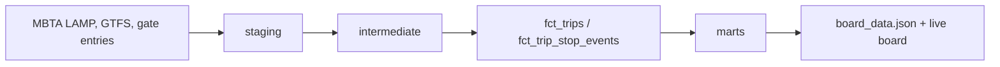

# Lantern

Where the Boston subway runs late, measured from recorded train runs.

**[Live board](https://neelvadlamudi.github.io/lantern/)** · [dbt docs](https://neelvadlamudi.github.io/lantern/dbt/) · [Portfolio](https://neelvadlamudi.github.io/neelresume/)

## The question

Which lines, stations and times of day run furthest behind schedule or leave the longest gaps between trains, how many riders does that touch, and is the data current?

## The result

On Oct 15, 2026, 12.0% of subway train runs over the last 90 service dates (19,108 of 158,795) ran 5 or more minutes over their scheduled run time, leaving out line-days with planned shutdowns. The board refreshes every day, so the live figure moves. Green Line D and the Red Line are tied as the most often late. Blue runs furthest over schedule relative to trip length, and the Green Line branches have the most uneven gaps between trains.

## How it's built

- **dbt Core and DuckDB.** DuckDB reads the MBTA files in place over HTTP, and dbt builds, tests and exports everything. There are no scripts outside dbt, and no accounts, keys or paid services.
- **Layers:** staging, then intermediate, then marts. Thresholds such as the 5-minute late rule live in one place as dbt vars.
- **Incremental loads** add new service dates each day and reprocess any days MBTA republishes.
- **Daily GitHub Actions refresh.** If MBTA has a bad day, the last good board stays live. The run only fails after 3 days in a row with no good build.
- **686 dbt tests across 119 models**, including tests that recompute each headline number from the fact tables on every build.



## Five models to read first

| Model | What it holds |
|---|---|
| `fct_trips` | One row per train run, with scheduled vs. actual time |
| `fct_trip_stop_events` | One row per train at a stop |
| `mart_rider_time_lost_daily` | Estimated rider time lost, weighted by fare-gate entries |
| `mart_segment_reliability` | Stop-to-stop segments ranked by delay |
| `mart_data_coverage` | Which dates loaded and whether the data is current |

## Tests that caught real data problems

- `assert_no_republished_files_missed`: MBTA re-uploaded Jul 16 and Sep 9, 2026 as empty files. The test caught it, and the pipeline now skips empty republishes and keeps the earlier rows.
- On Oct 22, 2026, MBTA's file index started returning errors. The build failed its checks, so the refresh kept the last good board instead of publishing a broken one.

## Run it

```
python3 -m venv .venv && . .venv/bin/activate && pip install -r requirements.txt
dbt deps --profiles-dir .
dbt build --profiles-dir .
```

Full details (metric definitions, lineage, every test, findings and limits) are in [docs/DETAILS.md](docs/DETAILS.md).

Public MBTA data. Not affiliated with the MBTA.
